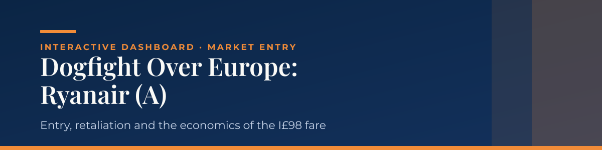

<b><a href="https://shab-analytics.github.io/RyanAir-dashboard/">▶ Open the live dashboard</a></b>

*In April 1986 a small Irish airline announced it would fly Dublin–London for I£98, less than half the flag carriers' cheapest unrestricted fare. Could it make money, and what would it cost Aer Lingus and British Airways to fight back? This dashboard lets you test the answer yourself.*

## *The business question*

*Ryanair had one 44-seat turboprop, four round trips a day and I£1 million of capital. Aer Lingus and British Airways flew the route 60–70% full and charged I£208 for an unrestricted return. Was Ryanair's launch a sound strategy, or just a low price?*

## *What you can test*

*Move five sliders and every figure, chart and table updates instantly:*

- *Ryanair's cost per seat compared with the incumbents'.*
- *The share of seats Ryanair fills (load factor).*
- *The fare it actually collects.*
- *The share of full-fare travellers who switch to the incumbents' cheaper fares if they cut prices.*
- *The share of Ryanair's passengers taken from the incumbents.*

## *What it shows*

| | |
|---|---|
| *Launch verdict* | *Viable, Marginal or Not viable at the chosen scenario, with the four tests behind it.* |
| *Ryanair's profit and break-even* | *Annual operating result, break-even load factor, margin of safety and cash runway.* |
| *Sensitivity* | *Profit by load factor, and a grid of profit at every cost and load combination.* |
| *Incumbent retaliation* | *The cost of matching I£98 on every ticket, matching only restricted fares, or tolerating Ryanair, against the route's profit.* |
| *Why retaliation is cheap* | *The incumbents' empty seats compared with Ryanair's entire capacity.* |

## *Key findings*

- *At the incumbents' cost per seat, Ryanair would need to fill 106% of its seats to break even, which is impossible.*
- *With seats 30% cheaper to fly, break-even falls to about 74% full.*
- *Matching I£98 on every ticket would cost the incumbents about I£34 million a year, six times the route's I£5.7 million profit, so a price war is not a credible threat.*
- *Matching only restricted fares is cheap, unless enough full-fare travellers switch to them; then tolerating Ryanair becomes the cheaper option.*

## *Method and assumptions*

- *Analysed from the April 1986 decision point, without hindsight.*
- *The case gives no Ryanair costs, so British Airways' 1986 average cost per passenger is used as the benchmark, and Ryanair's cost is tested as a percentage below it.*
- *Flight costs (fuel, crew, maintenance, landing fees) are treated as fixed once a flight is scheduled; selling and part of catering vary with passengers.*
- *Capacity assumes 365 days of operation. All money is in Irish pounds (I£).*
- *Results are scenarios built on stated assumptions, not forecasts.*

## *Built with*

*A single HTML page using D3.js. No installation needed: open the live link, or download index.html and open it in any browser.*

## *Source*

*Rivkin, J. W. (2007).* Dogfight over Europe: Ryanair (A) *(Harvard Business School Case No. 9-700-115). The case itself is not included; only my own analysis is shared here.*

*Prepared by Dr. Shabnam.*
